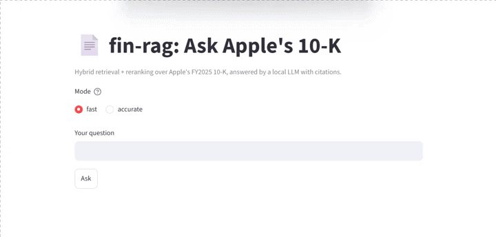

# fin-rag: Retrieval-Augmented QA over SEC 10-K Filings



A question-answering system for company financial reports. It retrieves the most relevant passages from a 10-K filing and (soon) generates cited answers from them. The project focuses on **measuring** retrieval quality: three chunking strategies and four retrieval methods are compared on a golden question set.

> **Status:** work in progress. Ingestion, chunking, retrieval and evaluation are done. Generation, API/UI and CI are next.

## Pipeline

```
SEC EDGAR 10-K (HTML)
  -> parse.py   split into Items, keep table rows as single lines, drop footers
  -> chunk.py   3 strategies: fixed / recursive / section-aware
  -> dense.py   embeddings (bge-small-en-v1.5) stored in Qdrant
  -> hybrid.py  BM25 + dense, merged with Reciprocal Rank Fusion
  -> rerank.py  cross-encoder (bge-reranker-base) re-sorts the top 20
  -> run_eval.py  recall@k and MRR against a golden question set
```

## Chunking strategies

| Strategy | How it works |
|---|---|
| Fixed | 500-token windows, 50-token overlap, cuts anywhere |
| Recursive | Packs whole lines (sentences or table rows) up to 500 tokens |
| Section-aware | Recursive, plus a header on every chunk (`Apple Inc. 2025 10-K \| Item 7: ...`) |

## Results (preliminary)

Corpus: Apple Inc. FY2025 10-K. Golden set: 46 questions (36 factual/numeric lookups, 10 prose questions from Risk Factors). A retrieved chunk counts as a hit if it contains the known answer string.

| Chunking | Method | R@1 | R@3 | R@5 | MRR |
|---|---|---|---|---|---|
| Fixed | dense | 0.67 | 0.85 | 0.89 | 0.76 |
| Fixed | bm25 | 0.63 | 0.80 | 0.91 | 0.74 |
| Fixed | hybrid | 0.70 | 0.91 | 0.93 | 0.80 |
| Fixed | hybrid + rerank | 0.57 | 0.83 | 0.96 | 0.70 |
| Recursive | dense | 0.52 | 0.80 | 0.87 | 0.66 |
| Recursive | bm25 | 0.61 | 0.85 | 0.89 | 0.72 |
| Recursive | hybrid | 0.57 | 0.91 | 0.93 | 0.72 |
| Recursive | hybrid + rerank | 0.61 | 0.89 | 0.96 | 0.75 |
| Section-aware | dense | 0.70 | 0.89 | 0.98 | 0.80 |
| Section-aware | bm25 | 0.61 | 0.80 | 0.91 | 0.72 |
| Section-aware | hybrid | 0.72 | 0.93 | 0.93 | 0.82 |
| **Section-aware** | **hybrid + rerank** | **0.89** | **1.00** | **1.00** | **0.94** |

**Headline:** baseline (fixed + dense) R@1 0.67, MRR 0.76 -> section-aware + hybrid + rerank R@1 0.89, MRR 0.94 on 46 questions.

## Findings

- **Fixed chunking splits table rows.** A fixed cut separated the `Total net sales | 416,161` row across two chunks.
- **Dense search misses exact numbers in repeated tables.** "Weighted-average diluted shares" never reached the top 5 with dense retrieval, though two chunks contained the number.
- **Reranking helped only section-aware chunks** (R@1 0.72 -> 0.89) and hurt R@1 on fixed chunks (0.70 -> 0.57). Hypothesis: headers and whole rows give the cross-encoder coherent text to judge. Not yet tested.
- **Section-aware chunking was the best or tied-best chunking** for dense, hybrid and BM25 on this set.

## Generation results (46 answerable + 8 unanswerable questions)

| Model | Strict match | Normalised match | Cited | Valid citations | Wrongly refused | Correct refusals |
|---|---|---|---|---|---|---|
| llama3.2:3b, base prompt | 0.67 | n/a | 1.00 | 0.98 | 0.00 | 8/8 |
| qwen2.5:7b, table-reading rule | 0.83 | **0.93** | 1.00 | 1.00 | 0.00 | 8/8 |

Retrieval was solid; the 3B model's main failure was misreading table columns and units (segment vs total rows, percent vs dollars, dropped thousands). A targeted prompt rule plus the 7B model fixed most of these.

Normalised match ignores spaces, commas, `$` and parentheses. It is still a string check, so it can pass an answer that adds a wrong derived figure (for example the deferred-revenue answer), and it cannot judge paraphrases. Run time for 54 questions on CPU: about 53 min (3B) vs 193 min (7B).

## Limitations

- One company, one filing, 20 questions. One question equals 0.05, so gaps of 0.05-0.10 are noise.
- Most questions are number lookups, which favor keyword matching. Prose questions are being added.
- Answer strings were chosen from chunks the system had already produced, so the test is friendlier than a blind one.
- The section header is part of the indexed text, and questions mention "Apple", so section-aware scores may be inflated. An ablation that strips the header before reranking is planned.
- Ten Risk Factors questions were drafted from chunks shown during development, so they are not fully blind.

## Quickstart

```powershell
python -m venv .venv
.venv\Scripts\Activate.ps1
pip install -r requirements.txt
python ingest/download.py
python ingest/parse.py
python ingest/chunk.py
python retrieval/dense.py index
python eval/run_eval.py
```

## Roadmap

## Roadmap

- [x] Golden set of 46 questions, including prose questions
- [x] LLM generation with inline citations and "I don't know" behavior
- [x] FastAPI backend and Streamlit UI
- [ ] Faithfulness evaluation with an LLM judge
- [ ] Docker
- [ ] More companies and years
